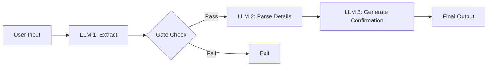
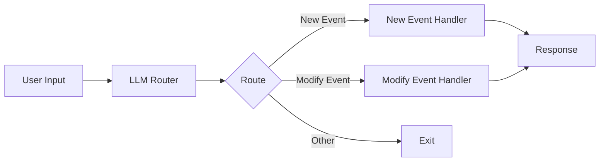
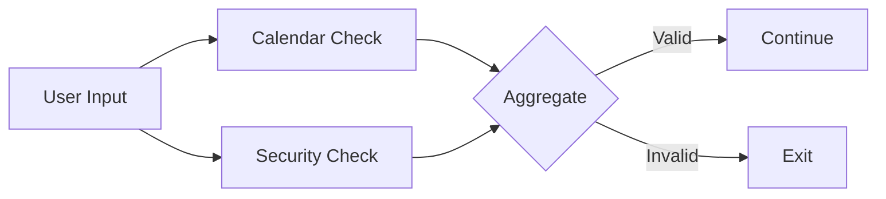
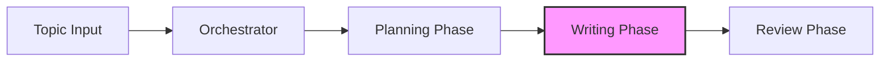

# Building Effective LLM Workflows in Pure Python

This repository contains practical patterns and examples for building effective LLM-powered systems using pure Python. Based on real-world implementations and lessons learned from working with production systems, these patterns focus on simplicity and composability rather than complex frameworks.

Whether you're building autonomous agents or structured workflows, you'll find proven patterns that can be implemented with just a few lines of code. Each pattern is illustrated with practical examples to help you understand when and how to apply them effectively.

This project provides code examples for the concepts discussed in:
- [Building Effective Agents](https://www.anthropic.com/research/building-effective-agents) - Anthropic's blog post
- [Practical LLM Patterns Video Guide](https://youtu.be/tx5OapbK-8A) - Video walkthrough of key concepts by Dave Ebbelaar

The core examples and detailed explanations for the workflow patterns can be found in the `patterns/workflows/` directory.

## Table of Contents

*   [Introduction](#building-effective-llm-workflows-in-pure-python)
*   [Workflow Patterns](#workflow-patterns)
    *   [Prompt Chaining](#prompt-chaining)
    *   [Routing](#routing)
    *   [Parallelization](#parallelization)
    *   [Orchestrator-Workers](#orchestrator-workers)
*   [Getting Started](#getting-started)
    *   [Prerequisites](#prerequisites)
    *   [Installation](#installation)
    *   [Configuration](#configuration)
*   [Usage](#usage)
*   [Contributing](#contributing)
*   [License](#license)


## Workflow Patterns

This section outlines several effective patterns for building robust LLM-powered systems. These patterns are designed to be simple, composable, and implementable with minimal code.

### Prompt Chaining

Prompt chaining is a powerful pattern that breaks down complex AI tasks into a sequence of smaller, more focused steps. Each step in the chain processes the output from the previous step, allowing for better control, validation, and reliability.

**Calendar Assistant Example (Prompt Chaining):**

Our calendar assistant demonstrates a 3-step prompt chain with validation:



**Step 1: Extract & Validate**
*   Determines if the input is actually a calendar request
*   Provides a confidence score
*   Acts as an initial filter to prevent processing invalid requests

**Step 2: Parse Details**
*   Extracts specific calendar information
*   Structures the data (date, time, participants, etc.)
*   Converts natural language to structured data

**Step 3: Generate Confirmation**
*   Creates a user-friendly confirmation message
*   Optionally generates calendar links
*   Provides the final user response

### Routing

Routing is a pattern that directs different types of requests to specialized handlers. This allows for optimized processing of distinct request types while maintaining a clean separation of concerns.

**Calendar Assistant Example (Routing):**

Our calendar assistant demonstrates routing between new event creation and event modification:



**Router:**
*   Classifies the request type (new/modify event)
*   Provides confidence scoring
*   Cleans and standardizes the input

**Specialized Handlers:**
*   New Event Handler: Creates calendar events
*   Modify Event Handler: Updates existing events
*   Each optimized for its specific task

### Parallelization

Parallelization runs multiple LLM calls concurrently to validate or analyze different aspects of a request simultaneously.

**Calendar Assistant Example (Parallelization):**

Our calendar assistant implements parallel validation guardrails:



**Parallel Checks:**
*   Calendar Validation: Verifies valid calendar request
*   Security Check: Screens for prompt injection
*   Run simultaneously for better performance

**Aggregation:**
*   Combines validation results
*   Applies validation rules
*   Makes final accept/reject decision

### Orchestrator-Workers

The orchestrator-workers pattern uses a central LLM to dynamically analyze tasks, coordinate specialized workers, and synthesize their results. This creates a flexible system that can adapt to different types of requests while maintaining specialized processing.

**Blog Writing Example (Orchestrator-Workers):**

Our blog writing system demonstrates the orchestrator pattern for content creation:



**Orchestrator:**
*   Analyzes the blog topic and requirements
*   Creates structured content plan
*   Coordinates section writing
*   Manages content flow and cohesion

**Planning Phase:**
*   Analyzes topic complexity
*   Identifies target audience
*   Breaks content into logical sections
*   Assigns word count per section
*   Defines writing style guidelines

**Writing Phase:**
*   Specialized workers write individual sections
*   Each section maintains context from previous sections
*   Follows style and length guidelines
*   Captures key points for each section

**Review Phase:**
*   Evaluates overall cohesion
*   Scores content flow (0-1)
*   Suggests section-specific improvements
*   Produces final polished version

For more details and code examples for each of these patterns, please see the [patterns/workflows/README.md](patterns/workflows/README.md) file.


## Getting Started

Follow these instructions to set up the project environment and start running the examples.

### Prerequisites

*   Python 3.8 or higher
*   Git
*   An OpenAI API key

### Installation

1.  **Clone the repository:**
    ```bash
    git clone https://github.com/your-username/your-repository-name.git
    cd your-repository-name
    ```
    *(Please replace `https://github.com/your-username/your-repository-name.git` with the actual URL of this repository if you know it, otherwise, leave as a placeholder).*

2.  **Create and activate a virtual environment (recommended):**
    ```bash
    python -m venv venv
    source venv/bin/activate  # On Windows use `venv\Scripts\activate`
    ```

3.  **Install dependencies:**
    The required Python packages are listed in `patterns/workflows/requirements.txt`. Install them using pip:
    ```bash
    pip install -r patterns/workflows/requirements.txt
    ```

### Configuration

1.  **Set up your OpenAI API Key:**
    The example scripts require an OpenAI API key to interact with the language models.
    *   Make a copy of the example environment file:
        ```bash
        cp .env.example .env
        ```
    *   Open the `.env` file and add your OpenAI API key:
        ```
        OPENAI_API_KEY='your_actual_api_key_here'
        ```
    The Python scripts use `python-dotenv` to load this key automatically.


## Usage

The example scripts demonstrating the various workflow patterns are located in the `patterns/workflows/` directory. Each subdirectory within `1-introduction` and `2-workflow-patterns` contains Python scripts that you can run directly.

For example, to run the basic LLM call script:
```bash
python patterns/workflows/1-introduction/1-basic.py
```

Navigate to the specific script you are interested in and execute it using Python:
```bash
python path/to/your_desired_script.py
```

Ensure you have completed the [Configuration](#configuration) steps, especially setting up your `OPENAI_API_KEY` in the `.env` file, before running the scripts.


## Contributing

Contributions to this repository are welcome! If you have suggestions for improvements, new patterns, or bug fixes, please feel free to:

1.  Fork the repository.
2.  Create a new branch for your feature or fix.
3.  Make your changes.
4.  Submit a pull request with a clear description of your changes.


## License

This project is licensed under the MIT License. See the [LICENCE](LICENCE) file for details.
